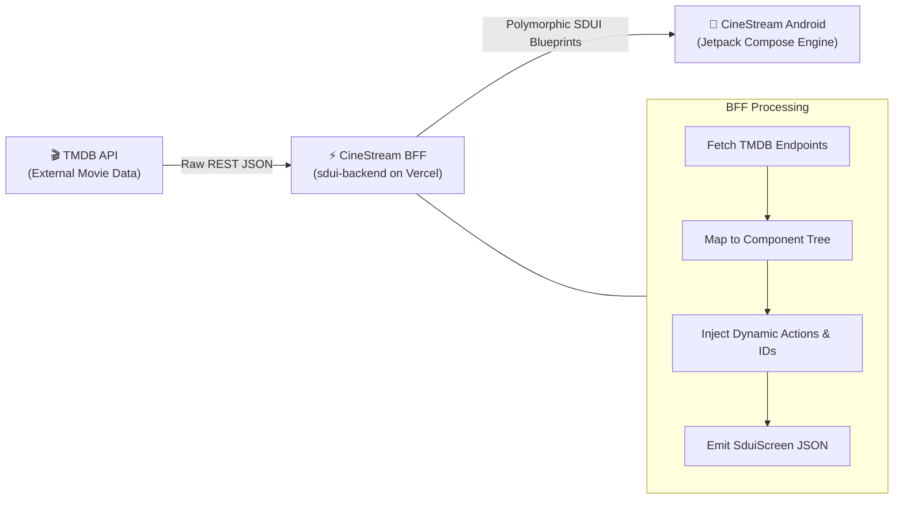

# CineStream SDUI Backend


This repository is the Backend-for-Frontend (BFF) server powering the **CineStream** Android application, designed to explore **Server-Driven UI (SDUI)** principles.

Instead of hardcoding UI hierarchy, styling, and navigation on the client, this server queries raw movie metadata from The Movie Database (TMDB) API, processes and maps it into dynamic JSON UI blueprints, and returns them to the client. The Android application acts as a declarative rendering engine via Jetpack Compose.

---

## 🔗 Project Linktree &amp; Ecosystem


| Resource                      | Link / Reference                                                                                                 | Description                                            |
| :----------------------------- | :---------------------------------------------------------------------------------------------------------------- | :------------------------------------------------------ |
| **Android Client (SDUI)**     | [AmmarAlGhifary/cinestream-sdui](https://github.com/AmmarAlGhifary/cinestream-sdui)                              | Native Android client with Jetpack Compose SDUI engine |
| **Backend BFF (This Repo)**   | [AmmarAlGhifary/cinestream-sdui-backend](https://github.com/AmmarAlGhifary/cinestream-sdui-backend)              | Serverless BFF generating SDUI blueprints              |
| **Live Production API**       | [https://sdui-backend.vercel.app/](https://sdui-backend.vercel.app/)                                             | Deployed production instance on Vercel                 |
| **Local Emulator Endpoint**   | `http://10.0.2.2:3000/`                                                                                          | Android emulator loopback to local Vercel dev server   |
| **TMDB API Documentation**    | [TMDB API v3 Docs](https://developer.themoviedb.org/reference/intro/getting-started)                             | External data source for movies, posters, and credits  |
| **Android Project Structure** | [PROJECT\_STRUCTURE.md](https://github.com/AmmarAlGhifary/cinestream-sdui/blob/development/PROJECT_STRUCTURE.md) | Multi-module layout of the Android application         |


---

## 🏛️ System Architecture



---

## 📡 Endpoints Specification

All serverless functions live in `/api` and conform to polymorphic `SduiScreen` specifications:


| Method | Endpoint                   | Rewrite Alias          | Query Parameters                                                           | Description                                                       |
| :------ | :-------------------------- | :---------------------- | :-------------------------------------------------------------------------- | :----------------------------------------------------------------- |
| `GET`  | `/api/index`               | `/`                    | None                                                                       | Service health check and endpoint directory                       |
| `GET`  | `/api/home`                | `/home`                | None                                                                       | Home dashboard: Hero banner + Trending and Upcoming carousels     |
| `GET`  | `/api/movie_detail_screen` | `/movie_detail_screen` | `movie_id` (required)                                                      | Detailed movie screen with metadata, overview, and similar movies |
| `GET`  | `/api/movie_list_screen`   | None                   | `list_type` (`trending` | `upcoming` | `similar`), `movie_id` (if similar) | Paginated / full vertical list view for categories                |
| `GET`  | `/api/search`              | None                   | `query` (required)                                                         | Search TMDB titles with vertical result listing                   |


---

## 🧩 SDUI Blueprint Contract

Every endpoint returns a polymorphic `screen` object consisting of a `toolbar` and a `body`:

```json
{
  "type": "screen",
  "screen_id": "movie_list_screen",
  "toolbar": {
    "type": "app_bar",
    "title": {
      "type": "toolbar_title",
      "text_content": "Trending Movies",
      "alignment": "start",
      "style": "headline"
    },
    "actions": []
  },
  "body": {
    "type": "vertical_list",
    "list_id": "movie_list",
    "items": [
      {
        "type": "movie_list_item",
        "movie_id": "936075",
        "poster_url": "https://image.tmdb.org/t/p/w500/...",
        "title": { "type": "text", "text_content": "Michael" },
        "subtitle": { "type": "text", "text_content": "7.0 | 2026-04-22" },
        "action": {
          "type": "navigation_action",
          "destination": "movie_detail_screen",
          "params": { "movie_id": "936075" }
        }
      }
    ]
  }
}
```

### Component Registry


| Server Type (`type`)   | Kotlin Client Model      | Category                       |
| :---------------------- | :------------------------ | :------------------------------ |
| `screen`               | `SduiScreen`             | Root Screen Container          |
| `app_bar`              | `SduiAppBar`             | Toolbar Layout                 |
| `toolbar_title`        | `SduiToolbarTitle`       | App Bar Typography             |
| `column`               | `SduiColumn`             | Vertical Layout Container      |
| `featured_hero`        | `SduiFeaturedHero`       | Hero Showcase Banner           |
| `featured_hero_detail` | `SduiFeaturedHeroDetail` | Detail Header Banner           |
| `section_header`       | `SduiSectionHeader`      | Section Title with Action      |
| `movie_carousel`       | `SduiMovieCarousel`      | Horizontal Scrollable Carousel |
| `movie_card`           | `SduiMovieCard`          | Poster Card Item               |
| `vertical_list`        | `SduiVerticalList`       | Vertical Scrollable List       |
| `movie_list_item`      | `SduiListItem`           | Horizontal Row Movie Item      |
| `navigation_action`    | `NavigationAction`       | Client Navigation Trigger      |


---

## 💻 Local Development

1. **Install Dependencies**:
   ```bash
    npm install
   ```
2. **Run Local Dev Server**:
   ```bash
    npm start
    # Runs: vercel dev --local --token dummy
   ```

    *The server starts on `http://localhost:3000`.*  
   
3. **Connect the Android Emulator**:
   - Point your Android app's base URL in `gradle.properties` to:  
  ```bash
    BASE_URL=http://10.0.2.2:3000/
   ```
   - Verify `android:usesCleartextTraffic="true"` in `AndroidManifest.xml` during local testing.
   
## 🚀 Deployment

Pushing to the `main` branch automatically deploys to Vercel production:

```bash
vercel --prod
```

---

## 👤 Author

- **Ammar Al Ghifary** - [GitHub](https://github.com/AmmarAlGhifary)